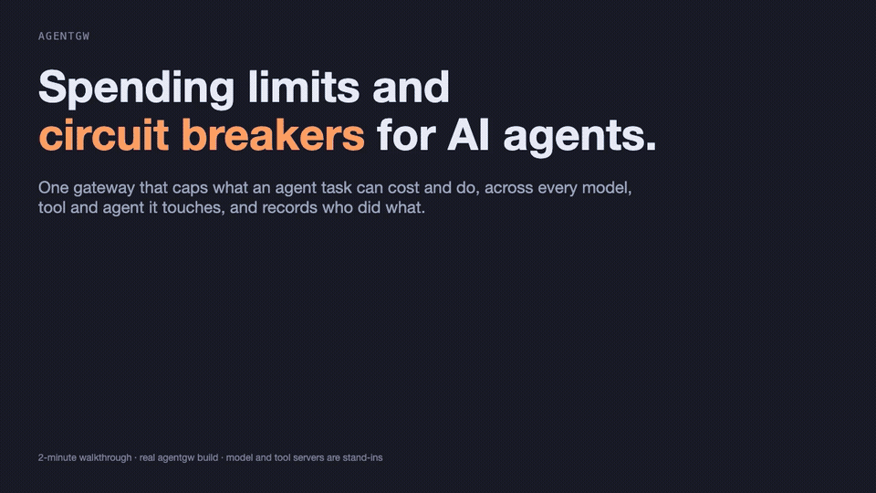

# agentgw website

Source for https://devopsarchaeologist.github.io/agentgw/, the public site
for agentgw, a gateway that caps what one AI agent task can cost and do
across every model, tool and agent it touches.

The demo above runs a real agentgw build against stand-in model and tool
servers. [Watch it as video](media/demo.mp4).

The site is one static `index.html` served by GitHub Pages. The agentgw
source code is in a separate repository and is in private preview.

To ask for early access, [open an early-access request](https://github.com/DevOpsArchaeologist/agentgw/issues/new?template=early-access.yml).
